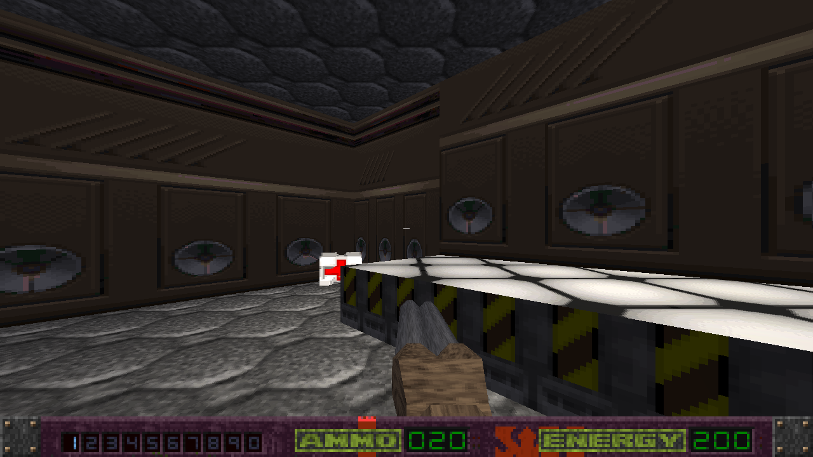
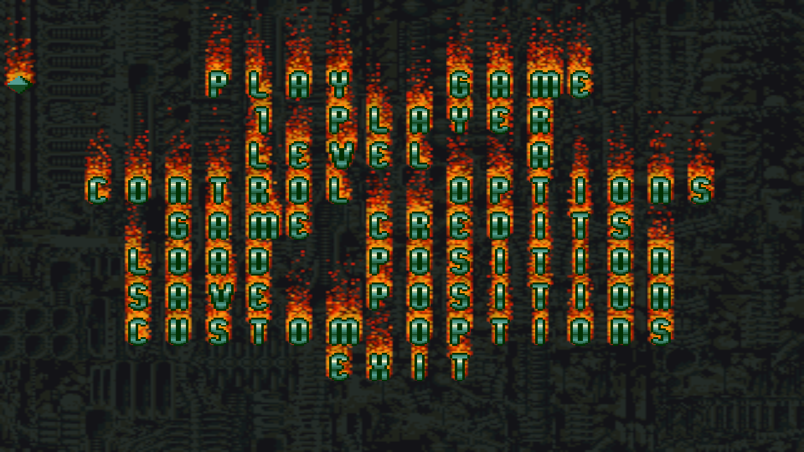
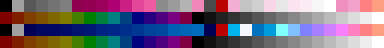
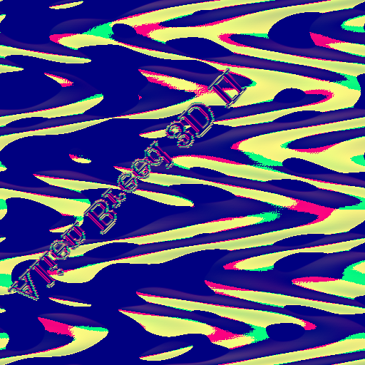
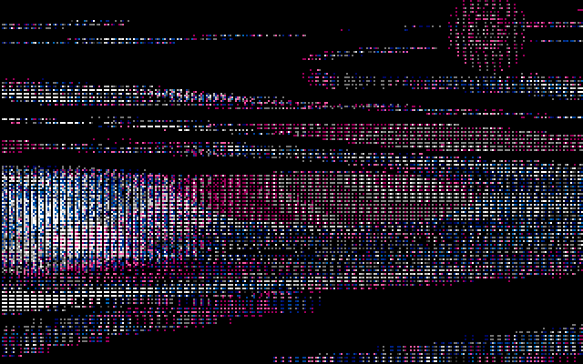
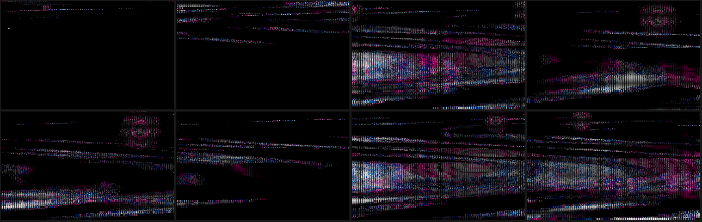
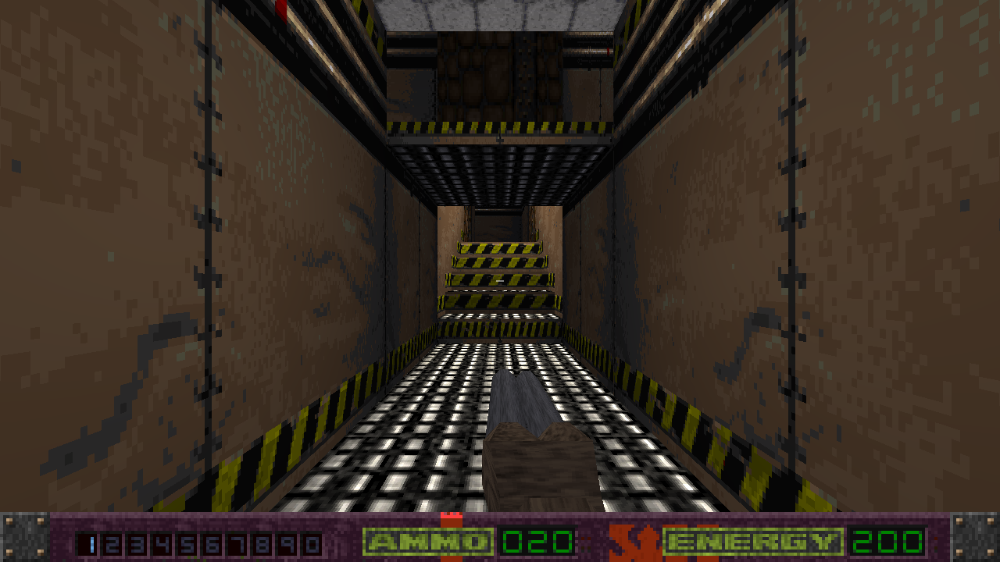
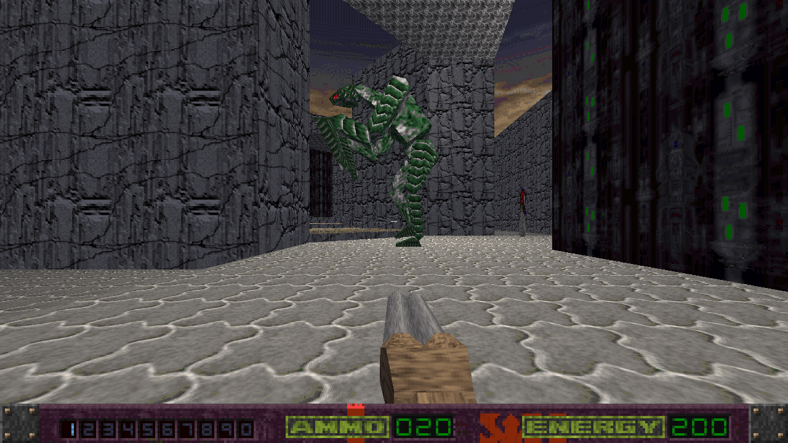

# AB3D2 Rebirth — the full 3D remake

*[Version française](README_fr.md)*

A **full 3D** remake of *Alien Breed 3D II: The Killing Grounds* (Team17, Amiga, 1996) on
**jMonkeyEngine 3**, built from the faithful Java port of the original engine.

> ⚠️ **Work in progress**, not a version playable from start to finish.



*Level A. Same simulation as the original port, lamp lighting, cast shadows, real vertical
aiming.*

---

## The principle

This project is not just another port: it is a **different engine**. It does not replay the
original rasteriser; it rebuilds the levels in true 3D and replays the same game logic.

> **The three readings of the game**: the
> [literal port](https://github.com/guillaumemonet/ab3d2-tkg-java), translated instruction by
> instruction, which serves as the **oracle** for the other two; the
> [object conversion](https://github.com/guillaumemonet/ab3d2-tkg-full-java), the same game in real
> Java without flat memory; and **this remake**, which changes engine. This repository also hosts
> the **extractors** that produce the reference corpus for all three.

> ⚠️ **Known debt**: this repository built the measuring instruments and never measured itself.
> Its simulation (`src/ab3d2/rebirth/sim/`) is a fork taken **before** the twenty or so oracle
> campaigns that corrected `full`. Figures, identified bugs and catch-up plan:
> **[docs/DETTE-SIMULATION.md](docs/DETTE-SIMULATION.md)**.

- **The port (`../java`) is the oracle.** It is compiled with this project
  (`srcDirs = ['src', '../java/src']`) and serves as the **authoritative reader** of the original
  formats for asset extraction. When a game rule is in doubt, it is the port that settles it; if
  need be, we go back to the assembly (`../../ab3d2-tkg/ab3d2_source`).
  **Its code is never modified.**
- **As many jME tools as possible.** Materials in `.j3m`, scenes in `.j3o`, shaders in `assets/`:
  everything the game displays must be openable and fixable by hand, or in the jME SDK, without
  recompiling.
- **jME opens the way to Android**, which is one of the reasons the engine was chosen.

---

## The assets: everything can be regenerated

**No game data is versioned.** Only the shaders, which are ours, are. Everything else is
rebuilt from the five floppy disks (see the port for how to recover them):

```bash
gradle -p rebirth extract      # original assets   -> PNG / JSON / OBJ / WAV
gradle -p rebirth materials    # materials          -> assets/materials/*.j3m
gradle -p rebirth scenes       # levels             -> assets/Scenes/*.j3o
```

| | format | editable by hand |
| --- | --- | --- |
| textures, sprites | PNG | ✅ |
| sounds, music | WAV | ✅ |
| materials (walls, floors) | **`.j3m`** | ✅ |
| levels | **`.j3o`** | ✅ |
| shaders | GLSL + `.j3md` | ✅ (versioned) |
| vector models | OBJ + `.lvl` sidecar | ⚠️ see below |

The **vector models** stay in OBJ: each face carries its directional lighting data
(`frame_NNN.lvl`, base level + angle sector) and the mesh is *regenerated when the light
changes*. A frozen `.j3o` would break that lighting.

Their **scale** comes from the assembly, not from eyeballing. A model point and the position of
the object carrying it meet in the same accumulator just before the perspective division: the
ratio of their two factors gives the exact scale, independent of the projection. It is 1/4 of a
level word on all three axes, i.e. **1 OBJ unit = 1 world unit**. The value previously set by eye
(0.75) made models half again too big: a shotgun 1.86 units long while the player's eye is at
1.70. Only the weapon in hand is exempt — the original forces its depth to 1
(`DRAW_VECTOR_NEAR_PLANE`), so its on-screen size does not come from the world and it keeps its
own factor.

### Two `.j3m` pitfalls

- **`Repeat` is essential.** Without it the walls lose their pattern and the edge of the image
  stretches into vertical streaks.
- **Filtering cannot be expressed in `.j3m`.** `LevelBuilder.pixelate()` sets "nearest
  neighbour" again after loading — including on materials that come back in a `.j3o` scene —
  otherwise jME interpolates and the 1996 textures turn blurry.

---



*The original menu — scrolling background, burning text — carried over identically. The fire is
a literal port of the three Amiga blits `D = A_décalé | (B & C)`, where `A` is a plane of the
font: it is the text itself that feeds the flames.*

---

## The intro, which was compiled

The boot disks' startup sequence fits in two lines:

```
intro.exe
tkg1:tkg
```

So the intro is a separate program, launched before the game — and opening it shows nothing,
because it is a **crunched** Amiga executable (StoneCracker 4.04): 24,724 bytes that unfold into
69,474.

The unpacker was not reconstructed from memory: it is ported **instruction by instruction** from
the 68k that the file itself carries, hunk 1 starting with 0x188 bytes of decruncher followed by
the `S404` marker. The stream is read backwards — reading and writing go downwards, bits come out
of the top of a 16-bit window — and the check is that the two pointers meet **exactly**: a wrong
unpacker would not land right to the bit.

What comes out is not a flat memory image but a stream of hunks, which must in turn be unrolled
(same 68k code, right after). Once separated:

| hunk | memory | size | contents |
| --- | --- | --- | --- |
| 0 | fast | 58 KB | the code, its tables, the images |
| 1 | fast | 1.4 MB | work buffer, empty in the file |
| 2 | **CHIP** | 10 KB | what the hardware reads directly |
| 3 | CHIP | 313 KB | the screens, empty in the file |

No file names in its strings: the intro is self-contained, it loads nothing.

### What the intro does

Hunk 0 disassembles (Capstone can read 68k). The entry point jumps to `$1548`, which takes over
the hardware, calls **`$2a00`** — the body — then hands it back. And `$2a00` fits in fifteen
lines: three initialisations, a loop of **11,942 iterations** over three routines, waiting for
the beam, and stopping.

The rendering routine (`$2b56`) writes **16,000 longwords, i.e. exactly 320 × 200 bytes**, by
table lookup: for each pixel, a pair read from a traversal table, a perturbation taken from a
second one, and a colour drawn from a third. That is what the 1.4 MB buffer is for — it holds
nothing but precomputed tables. `$2aea` divides `640` by the depth: a perspective division. And
four sine phases, advanced by −7, +2, +4 and −3 per frame, make the whole thing move.

The images, for their part, are where the intro goes to fetch them — the disassembly gives the
three instructions:

| address | instruction | what it loads |
| --- | --- | --- |
| `$310C` | `lea $75f8,a0` | the title, 320 × 40 |
| `$316A` | `lea $a7f8,a0` | the Team17 logo, 160 × 48 |
| `$317E` | `lea $c5f8,a0` | the Ocean logo, 160 × 48 |


The title is not displayed as is. `$310C` stamps it column by column into two hunk 1 tables,
**with a stride of 0x201** — that is, one row lower and one column further for each byte, hence
diagonally in a map 512 wide — keeping only the maximum. In other words: the title is **embossed
into the bump map** that the engine then deforms. That is why it is nowhere to be found as a
screen.

The two logos go through a chunky → bitplanes conversion routine that writes into CHIP memory in
rows of 20 bytes: 160 pixels wide, 48 high.

The images are **chunky** — one byte per pixel — the title stored column by column and bottom to
top, the logos row by row.

### The palette

It is not stored with the images: the intro builds it, and its builder is at `$320E`. The source
table is at **`$6F78`** — four banks of 32 colours, four bytes each (`00 RR GG BB`), hence
**24-bit**. The code scales each component by a fade factor, then splits it in two — high bits
and low bits — to write **two** Copper lists bracketed by `BPLCON3 = $0000` and `$0200`: the AGA
technique that gives 8 bits per channel where the Copper only addresses 4.



Banks 1 and 3 are a hue wheel followed by a perfect grey ramp, for the engine's use. Banks 0
(pink) and 2 (blue) dress the logo screen — and it really is a single screen: `$316A` writes the
two logos **side by side**, at hunk 3 `+0` and `+20` bytes, i.e. 160 + 160 = 320 pixels. So they
necessarily share their colours, and the intro switches from one mood to the other.

 

The title, for its part, has no palette of its own: embossed into the bump map, it takes the
colours the engine computes. So it comes out in greyscale, normalised to its maximum, which
restores the original anti-aliasing but not its hues.

### The complete map of hunk 0

By collecting every address the code fetches — 31 in all, all absolute `lea` or `move` — the map
closes exactly on the end of the hunk. Nothing is left unexplained:

| range | contents |
| --- | --- |
| `0x00000`–`0x04F00` | the code |
| `0x04F14`–`0x04F5E` | the rasteriser's working variables (a quad, its vertices) |
| `0x05760`, `0x06160` | its edge buffers |
| `0x06B60`–`0x06B78` | the motion variables: four sine phases, the position |
| `0x06B78`–`0x06F78` | **tunnel palette**, 256 colours |
| `0x06F38`–`0x06F78` | 16 entries written at run time by `$2C02` (a red ramp) |
| `0x06F78`–`0x071F8` | **5 banks of 32 colours** |
| `0x071F8`–`0x075F8` | **sine table**, 512 entries, amplitude 1023 |
| `0x075F8`–`0x0A7F8` | the title, 320 × 40 |
| `0x0A7F8`–`0x0C5F8` | the Team17 logo, 160 × 48 |
| `0x0C5F8`–`0x0E3F5` | the Ocean logo, 160 × 48 — and that is the end of the hunk |


The two palettes are not used in the same place. The banks dress the logo screen; the 256-colour
ramp, for its part, is expanded by `$2C1A` towards `hunk1+0x030000` — precisely the table the
rendering loop looks up for each group of pixels. So it is the **tunnel**'s.

And the effect can be guessed from its tables: `$2C3A` fills a 256 × 256 map with
`(x − 127)² + (y − 127)²` passed through an inverse table and brought down to 0–63. A radial
field — the signature of a tunnel. The rest of the 1.4 MB is of the same kind: tables, nothing
but tables, which explains why they are absent from the file and rebuilt at launch.

### Running the engine

The sequence is stored nowhere: it is computed. Rather than **transcribing** the engine — some
ten table-generation routines, where the slightest error would go unnoticed — we **execute** it.
`tools/intro68k/` contains a 68000 interpreter of about five hundred lines (decoding by
Capstone) and a harness that calls the same routines as `$2A00`, in the same order, skipping only
those that talk only to the hardware.

Two things have to be supplied by hand, because they come from the system and not from the
program: bit 0 of `$15DF`, which the startup framework sets when its beam interrupt is in place,
and `$2EC2` itself — it is this interrupt that makes time advance, so it is called once per
frame. Without the former, `$2EC2` returns immediately and nothing moves.



Here is the proof that the whole chain is right. This image is the **normal map** that `$2DAA`
computes after 26 million instructions: a marbled field, with **"Alien Breed 3D II" engraved
diagonally** across it — exactly where the `0x201` stride of `$310C` puts it. So the title is
not displayed, it is *embossed*: it is a **bump mapping** effect, the relief of the text lit by a
moving patch of light.



And here is the result: a **glowing ball flies over a dark plane and lights it as it passes**.
The relief of the plane — and the title engraved in it — exists only where the light falls.



One frame every 40, from the 40th to the 320th: the ball enters from the right, the lit band
swells, sweeps, then fades.

**The palette is a trap.** There are two, and I first took the wrong one. The one at `0x6B78`,
256 colours, is the **engine's source** palette: `$2C1A` expands it towards `hunk1+0x030000` for
the rendering loop to draw from. But what the rendering *writes* are screen indices — and the
screen is described by the Copper template: `BPLCON0 = $7201` at `0x44CA`, i.e. **seven
bitplanes**. Hence **128 colours**, and bit 7 of the pixel byte is not displayed.

Those 128 colours are the four banks of 32 that `$320E` sends to the Copper, **one bank per
pass** — `addi.l #$2000,d6`, the BANK field of `BPLCON3`. Applying the source palette gave the
right shapes on a dark red background; the right one gives a black background and a
blue-white-pink light.

The dithering, for its part, is original: each entry of the colour table holds **four pixels**
in a longword, which produces those checkerboard gradients that blended together on a CRT
screen.

```bash
gradle -p rebirth intro                  # drops the hunks into assets/intro/
cd tools/intro68k && python3 runintro.py 200
```

A word of caution: nothing here certifies **pixel accuracy**. Lacking a reference — that would
take an emulator alongside — I can say that the engine runs, that its tables are the ones it
really builds and that the title is in them, but not that the image is identical to the 1996
one. Count one second per frame; the interpreter is in Python, it is an archaeology tool, not a
renderer.

### The music

Hunk 2 — the 10 KB in CHIP memory, the only memory Paula can read — is the tune. It is a
home-made tracker, but with an obvious kinship to MOD: its cells are four bytes and read exactly
the same way. Its player is at `$0008`, and the layout can be read from it:

| offset | contents |
| --- | --- |
| `0x000` | 31 entries of 8 bytes: length, volume, loop, loop length |
| `0x0F8` | song length, then a "table already converted" flag |
| `0x0FA` | 4 channels × 128 positions: one **track** number per slot, stored **by channel** |
| `0x2FA` | `nb_pistes × 64` words: each word refers to a cell |
| … | a longword giving the size of the cell pool, then the cells, then the sample |

That is the trick: cells are **not repeated**, the tracks refer to them. This tune fits in 41
cells — a single 8 KB sample, five notes, and twenty-eight volume settings that sculpt its
envelopes by hand. The rebuilt `.mod` unfolds everything, one track per channel and per
position: bigger, but readable by any player.

The read check is that the sample ends **exactly** at the end of the hunk — to the byte, which
leaves little room for a misinterpretation of the layout.

```bash
gradle -p rebirth intro
```

---

## The `.j3o` scenes

The game **loads** `assets/Scenes/level_<x>.j3o` when it exists: fixing a wall in the SDK shows
up in game. `-Pnolevelscene` forces the old path (rebuilding from the JSON), which makes it
possible to compare the two at any time — they are **pixel-identical**.

The scene contains only the **scenery**. Objects (pickups, animated scenery, monsters) are
entities the game places and removes during play: freezing them would make no sense.

The **moving** parts of the scenery are re-attached **by node name** after loading. A name that
refers to two nodes goes unnoticed — `Node.getChild` returns whichever comes first, the wrong
object gets animated and nothing complains. So loading checks that each re-attached node really
carries the expected geometry, and says so out loud otherwise:

| node | role |
| --- | --- |
| `lift_zone_<id>` | lift floor |
| `door_zone_<id>` | door-zone ceiling (the underside of the door leaf) |
| `jambs_zone_<id>` | a door or lift zone's own walls: the jambs, **fixed** |
| `deform_<n>_<clé>` | group of walls that door/lift `<n>` deforms |
| `water_<id>` | water surface |
| `flat_tile<n>`, `wall_<clé>` | static scenery |



*Level C, zone 117. The game stacks two floors in the same sector: one zone carries **two**
geometry streams. The extraction read only one and the whole upper storey was missing — here the
walkway above the staircase.*

---

## Entities: not all of them are billboards



*Level P. The Mantis boss is a 256-triangle mesh, not a sprite — as in the original game. On the
right, a guard: that one really is a billboard.*

The game stores monsters and objects in the same entity table, and chooses how to draw them by a
**data field**, not by a category: `draw_Object` looks at a field of the entity and goes to
either `draw_Bitmap` or `draw_PolygonModel`. Nine monsters are in the second case — the
**Wasp**, **Crab** and **Mantis** bosses, spread across H, L, O and P.

Two pitfalls came one after the other. First, the remake forced every entity in the monster
table to be a billboard; since a vector entity has no "sprite sheet" field, they received sheet
0, hence the wrong graphics. Then, once wired to their model, they all displayed the **same**
one: the extraction read the index from the `GFXType` word, which carries only the "vector" flag
and is therefore 1 for all of them. The real index is **byte 0 of the animation step**
(`ai.s:1917`), exactly as for a vector object. The check that proves it fits in one line: entity
names and model names now match (*Mantis Boss* → `MANTIS`), which was the case for none of the
nine.

These bosses **animate** like the others: the field the simulation calls `sheet` is their model
index, and its frame selects one of the meshes (13 for the Wasp, 20 for the Crab and the
Mantis). Unlike a billboard, a mesh **rotates** instead of billboarding, and the sign of the
frame — which for a sprite controls mirroring — does not apply.

---

## Lighting

One light per zone, all attached to the root. Only the zones **potentially visible** from the
player's zone are lit — the original game's PVS, which is extracted with the rest:

| level | lights | lit |
| --- | --- | --- |
| A | 134 | 11 |
| C | 199 | 14 |
| O | 166 | 37 |

**Dropping a light means zeroing its RADIUS, not its colour.** jME filters lights by testing
their radius against the bounding volume of each geometry (`DefaultLightFilter`): a black light
with a large radius stays in the batch and still costs its pass. The first version of this
culling switched off the colour and therefore gained **nothing** — the engine's counters gave the
same number of submissions with and without it.

Measured, VSync off, three runs per case (`-PfpsLog -Pnovsync`, against `-PnoPvsLights`):

| level | without culling | with culling | submissions |
| --- | --- | --- | --- |
| A | 175-178 fps | **231-233** | 306 → 157 |
| C | 306-322 fps | **360-406** | 135 → 74 |
| O | 102-111 fps | **147-150** | 718 → 580 |

That is 20 to 38%, and roughly half as many draw calls.

What costs in this engine is the **submissions**, not the shading: `-Pfullbright` gains only 2%,
`-Pnoshadow` 9%. And enlarging the light batch is counter-productive — `lightBatch=8` goes down to
456 submissions but drops to 105 fps, `16` to 349 and 92 fps, each pass then evaluating more
lights per fragment. The default of **4** is the right one.

Invisible in the image (verified): a light outside the PVS lit nothing that can be seen.

---

## Running

```bash
gradle -p rebirth run                 # the game
gradle -p rebirth run -Plevel=c       # another level
gradle -p rebirth moveTest shotTest alienTest [-Plevel=c]   # simulation, headless
gradle -p rebirth menuTest            # the menu
```

A few useful options: `-Pnolevelscene` (rebuild instead of loading the scene), `-Pretro`
(emulation of the original rasteriser), `-Pfullbright`, `-PlightLog`, `-PdeformLog`,
`-Pshot=N` (screenshot after N frames), `-Pnosound`.

For measuring: `-PfpsLog` prints the average frame time, the number of submissions and the
splitting of the tree into geometries, `-Pnovsync` lifts the refresh-rate cap (without it every
measurement gives 60 and means nothing), `-PnoPvsLights` turns all the lights back on to serve as
a reference — to be added with `-Pfreecam` too, whose camera leaves the player's zone and
therefore ends up in the dark.

## Opening in the jME SDK

**Extract the assets first.** After cloning, `assets/` contains only the shaders — everything
else comes from the floppy disks. An SDK opened on an empty folder has nothing to show:

```bash
gradle -p rebirth extract && gradle -p rebirth materials && gradle -p rebirth scenes
```

The folder is a jME project (`nbproject/`, modelled on the SDK's official template). Gradle
remains the reference build; the Ant build writes into `build-nb/` so as not to tread on it.

Two details of this `nbproject/` are worth knowing, because they look alike and are not handled
the same way. `build-impl.xml` is **regenerated** by NetBeans every time the project is opened:
it has no business in the repository. `assets-impl.xml`, on the other hand, is written only when
the wizard **creates** the project; so it is versioned. Ignoring it left the `assets` extension
declared by `project.xml` pointing at nothing, and the project opened without its assets.

Finally, `assets.excludes` is **empty** here, whereas the SDK template uses it to exclude source
formats meant to be converted to `.j3o`. Here they are runtime data: the vector models stay in
`.obj` and the game tables are `.bin` files.

---

## Legal Notice & Game Assets

### Independent Engine Implementation

This project is an independent reimplementation of the *Alien Breed 3D II: The Killing Grounds* engine, designed to reproduce the original game's behavior on modern platforms.

The engine has been developed from the original source code (68000 assembly and C), as published in [mheyer32/alienbreed3d2](https://github.com/mheyer32/alienbreed3d2), through technical analysis and compatibility testing. That source code is not included in this repository; the remake builds on the faithful Java port made from it.

### Original Game Files

This project requires original game files, such as the game's five Amiga ADF disk images, to run.

**Original game files are not included in this project.**

Users must obtain and provide their own game files from a legally authorized source. Before downloading or using this engine, users are required to confirm that they possess a legally obtained copy of the original game.

No game data is versioned: textures, sounds, materials and scenes are regenerated from the disks. Only the shaders, written for the remake, are in the repository.

Eloane Studio does not host, distribute, or provide unauthorized copies of copyrighted game assets.

### Copyright & Trademarks

All original game names, trademarks, graphics, music, and other proprietary assets of *Alien Breed 3D II: The Killing Grounds* remain the property of their respective copyright holders (Team17).

This project is an independent, unofficial implementation and is not affiliated with, endorsed by, or sponsored by the original game's developers or publishers.

### Preservation

The purpose of this project is to preserve the technical behavior and gameplay experience of classic video games while making them accessible on modern systems.

The engine is provided for compatibility, preservation, and educational purposes.

### Credits

Original engine: Team17 (Andy Clitheroe et al.). Reference ASM/C sources: [mheyer32/alienbreed3d2](https://github.com/mheyer32/alienbreed3d2). 3D remake: **Guillaume Monet**.
